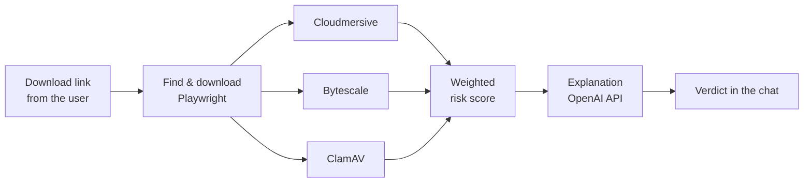

# SafeDLBuddy

**An AI-powered assistant that tells you whether a file is safe to download.**

Paste a link to a download page into the chat. SafeDLBuddy finds the real file behind the page, downloads it to temporary storage, scans it with three antivirus engines, combines their results into one risk score, and explains the verdict in plain language. The file is deleted once the scan is done.

Final project for my B.Sc. in Software Engineering at Afeka College of Engineering (2024–2025, grade: 92).

---

## How it works



1. **Understand the message.** The OpenAI API reads each chat message and decides whether it is a link to scan or a question to answer.
2. **Find the real file.** Download pages rarely link to the file directly. Playwright opens the page in a headless browser and extracts the actual download links. The user picks the file to scan.
3. **Download safely.** The file is downloaded to temporary storage, with timeouts, retries and a stop button.
4. **Scan.** The file is sent to three antivirus engines in parallel.
5. **Score.** The results are combined into one weighted score and a verdict: **Safe**, **Suspicious**, **Malicious** or **Unknown**.
6. **Explain.** The OpenAI API explains the verdict using the actual scan results, and the user can ask follow-up questions.

## Key features

- **Supported sources:** Google Drive, Dropbox, OneDrive, MEGA, GitHub, direct links, generic download pages and torrents (magnet links).
- **Weighted multi-engine scoring:** each engine has a weight based on a six-factor comparison (detection rate, reliability, cost, response time, features, integration complexity).

  | Engine       | Weight |
  | ------------ | ------ |
  | Cloudmersive | 37%    |
  | Bytescale    | 34%    |
  | ClamAV       | 29%    |

- **Engine failover:** if an engine is unavailable, its weight is redistributed across the others so the score stays valid. If two engines fail, the verdict is "Unknown" instead of a guess.
- **Conflict handling:** the verdict rules take into account how many engines flagged the file, not only the average score.
- **Live progress:** the frontend receives progress updates through Server-Sent Events.
- **Privacy:** downloaded files are deleted after processing.

## Tech stack

| Area               | Technologies                            |
| ------------------ | --------------------------------------- |
| Frontend           | Vue.js 3, Vite, Axios                   |
| Backend            | Node.js, Express                        |
| Browser automation | Playwright                              |
| Antivirus engines  | Cloudmersive API, Bytescale API, ClamAV |
| AI                 | OpenAI API                              |
| Testing            | Jest                                    |
| Deployment         | Docker, Docker Compose, Azure           |

## Architecture

The system runs as three services:

| Service             | Port | Role                                                                |
| ------------------- | ---- | ------------------------------------------------------------------- |
| `frontend`          | 5173 | Vue.js chat interface                                               |
| `openai_backend`    | 3000 | Chat, intent detection, link extraction and downloads, explanations |
| `antivirus_backend` | 4000 | Scanning with the three engines and the weighted score              |

```
SafeDLBuddy/
├── docker-compose.yml
├── frontend/                  # Vue.js app (ChatBot.vue is the main UI)
└── backend/
    ├── openAi_backend/        # Chat and orchestration service
    ├── Antivirus_backend/     # Scanning service
    ├── file_handler.js        # Main download router
    ├── *_handling.js          # One handler per source (Drive, Dropbox, MEGA, ...)
    ├── torrent.mjs            # Torrent / magnet downloads
    └── tests/                 # Jest test suites
```

## Getting started

### Prerequisites

- Docker and Docker Compose, **or** Node.js 18+ and ClamAV installed locally
- API keys for OpenAI, Cloudmersive and Bytescale

### Environment variables

Create `backend/.env`:

```env
OPENAI_API_KEY=your_openai_key
CLOUDMERSIVE_API_KEY=your_cloudmersive_key
BYTESCALE_SECRET_KEY=your_bytescale_key
SCAN_URL=http://antivirus_backend:4000
ADMIN_KEY=choose_an_admin_key
```

Create `frontend/.env`:

```env
VITE_OPENAI_API_URL=http://localhost:3000
VITE_ANTIVIRUS_API_URL=http://localhost:4000
```

> When running without Docker, set `SCAN_URL=http://localhost:4000`.
> The `.env` files are in `.gitignore`. Never commit API keys.

### Run with Docker

```bash
docker-compose up --build
```

Open http://localhost:5173.

### Run without Docker

```bash
# Backend
cd backend
npm install
npx playwright install chromium
node openAi_backend/openAi_server.js           # terminal 1
node Antivirus_backend/AntivirusAPIs_server.js  # terminal 2

# Frontend
cd frontend
npm install
npm run dev                                     # terminal 3
```

## Testing

The test suite has about 75 Jest tests, organized by test ID:

| Suite       | ID  | What it covers                                                                                                  |
| ----------- | --- | --------------------------------------------------------------------------------------------------------------- |
| Functional  | FT  | Scan flows, link handling, the stop button                                                                      |
| Integration | IT  | Communication between the services                                                                              |
| Security    | ST  | Known malware (EICAR), suspicious files, conflicting results, every engine-outage combination, network failures |
| Performance | PT  | URL processing speed, scan time, load and stress tests, large files                                             |
| Regression  | RT  | Stop/cancel behavior                                                                                            |

`tests/urls.json` holds a labeled dataset of 34 safe and 25 malicious URLs used by the tests.

```bash
cd backend
npm test                        # all tests (services must be running)
npm test -- tests/Security      # one suite
```
